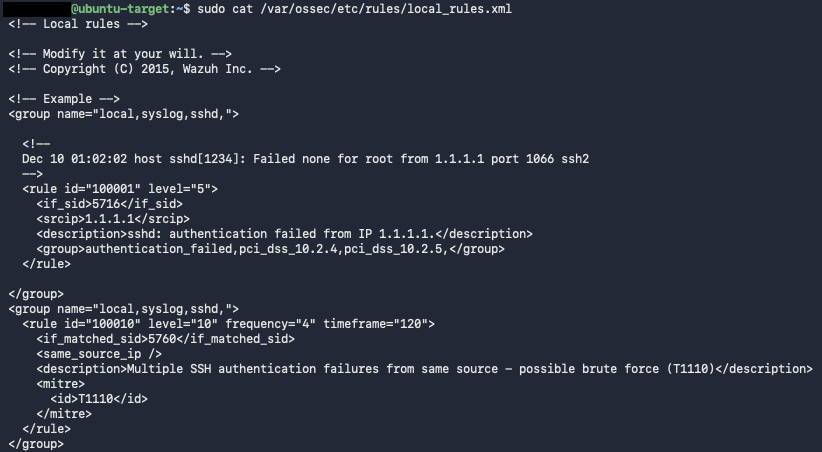
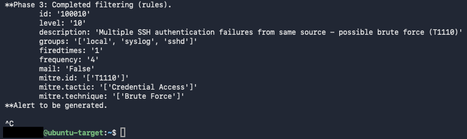
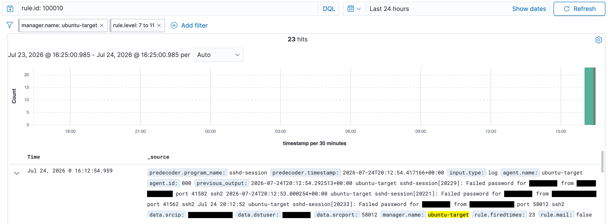
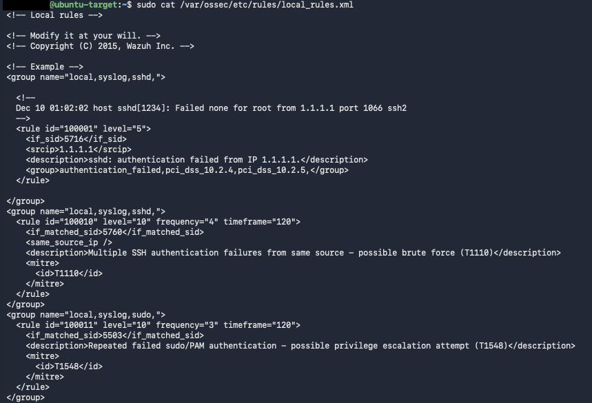
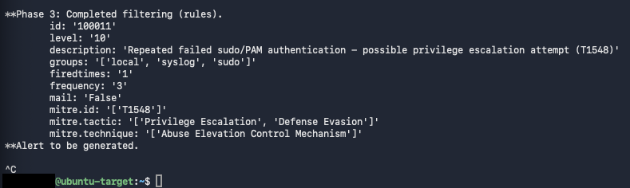
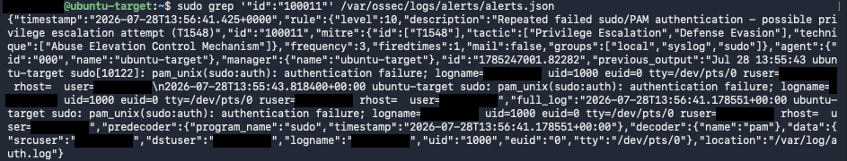
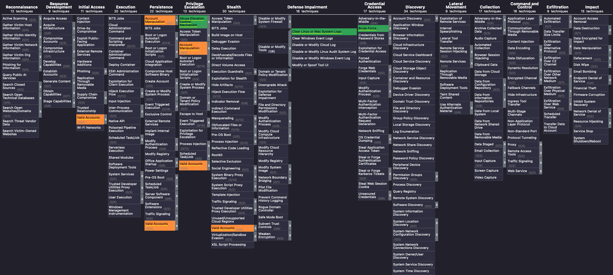
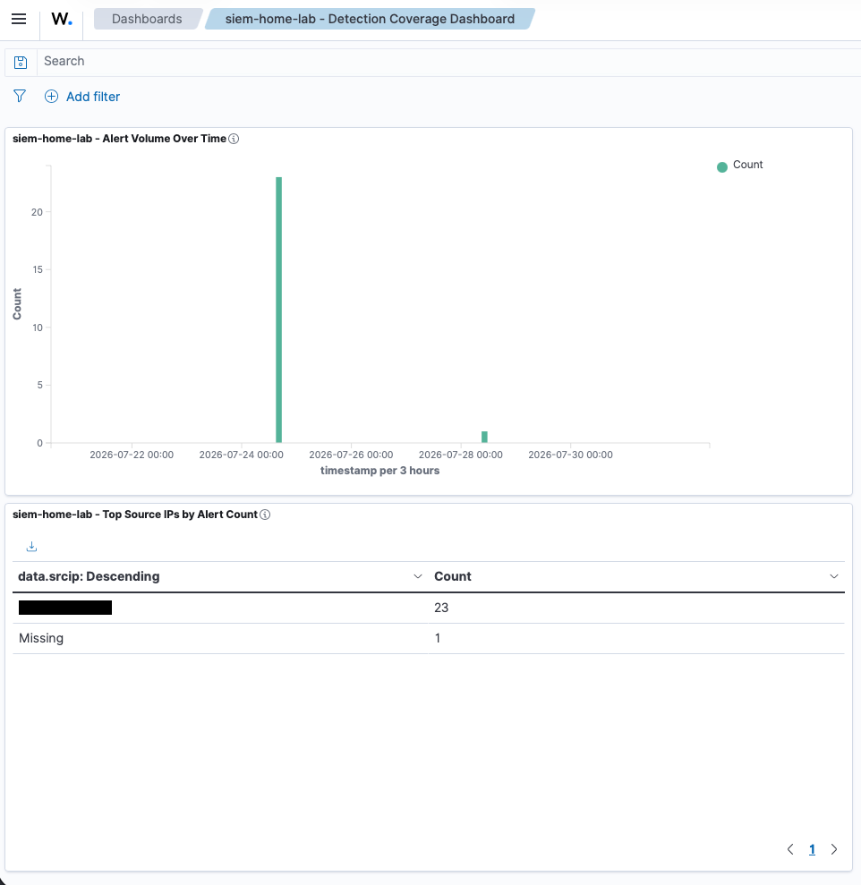

# Home SIEM Lab (Wazuh)

## What this demonstrates

Building and validating a custom SIEM detection rule: not just installing Wazuh, but proving the rule catches the attack it was written for, debugging it when it silently doesn't, and confirming the fix with a live attack before calling it done. Identifying values are replaced or redacted.

## Environment

- **Wazuh manager, indexer, and dashboard:** self-hosted, single-node, on an Ubuntu Server VM
- **Monitored host:** the same VM, via the Wazuh manager's local self-monitoring (agent ID `000`)
- **Attacker:** Kali Linux VM on the same lab network
- **Attack tool:** Hydra, for SSH credential brute-forcing

## Key findings

Four things this project established, each backed by evidence in the sections below.

**A rule that looks correct and a rule that actually fires are two different things.** Rule 100010 had two independent bugs: a missing frequency/timeframe pairing left it without its intended threshold, and an incorrect base rule ID kept it from matching at all. Both were found and fixed before it caught anything, and neither would have been obvious from a live attack alone. The discipline: validate the logic in isolation first, then confirm it against real traffic.

**Validating against a synthetic test line can validate the wrong thing.** Rule 100011 passed `wazuh-logtest` while still wrong, because the hand-written test line did not match the format of real `sudo` failures. The standard is not "trust `wazuh-logtest`" but "trust `wazuh-logtest` run against real data."

**A coverage layer paired with a curated roadmap is a prioritization tool, not a scorecard.** Showing what is proven alongside a few planned techniques — chosen for what the existing log sources can support, not from a generic wishlist — answers "what would you build next, and why?" The layer is extended as rules are added, not rebuilt.

**A frequency-based rule's alert count reflects triggered thresholds, not raw events.** That matters when reconciling a dashboard with a written incident record. Building the panels also showed how easily alert data from other projects bleeds into a filtered view when the time range isn't scoped deliberately.

## Process

### 1. Set up log ingestion

A Wazuh manager includes a built-in local agent (ID `000`) that reads the host's own logs, so the manager needs no separate agent package. The authentication log is added as a monitored source in `/var/ossec/etc/ossec.conf`, alongside the manager's existing defaults:

```xml
<localfile>
  <log_format>syslog</log_format>
  <location>/var/log/auth.log</location>
</localfile>
```

This file and the systemd journal, which the manager already reads, are the log sources for both detection rules below.

### 2. Write a custom detection rule for SSH brute-force attempts

```xml
<rule id="100010" level="10" frequency="4" timeframe="120">
  <if_matched_sid>5760</if_matched_sid>
  <same_source_ip />
  <description>Multiple SSH authentication failures from same source - possible brute force (T1110)</description>
  <mitre>
    <id>T1110</id>
  </mitre>
</rule>
```

This rule escalates repeated SSH authentication failures from the same source IP into a labeled brute-force alert, mapped to MITRE ATT&CK v19.2 technique **T1110 (Brute Force)**.

### 3. Debug it — the rule didn't fire on the first attempt

A live Hydra run produced alerts from several built-in Wazuh rules, but none from the custom rule ([alert counts](evidence/alert-counts-before-fixes.txt)). Rather than assume the rule was broken and guess at a fix, it was edited and checked with `wazuh-logtest` against a known sample log line. Ubuntu Server's authentication log records the sudo commands: the rule edited at 19:54 UTC, `wazuh-logtest` run at 20:03, and the base rule ID corrected at 20:08 (lines 1176, 1197, and 1200 of `auth_snapshot.log` in [`log-ioc-parser`](https://github.com/JSON-MSON/log-ioc-parser); line 1221 is the first failed password of the attack that confirmed the fix). Two distinct bugs were fixed:

- **Missing `frequency`/`timeframe` attributes.** `<if_matched_sid>` is meant to be paired with these attributes on the `<rule>` tag; they set how many matching events within how many seconds trigger the rule. Without them, Wazuh falls back to its defaults — two matching events within 360 seconds ([re-test](evidence/logtest-no-frequency-test.txt)) — so the rule did not express the intended threshold of four failures from one source within 120 seconds.
- **Wrong base rule ID.** The base rule ID was assumed rather than checked; `wazuh-logtest` showed this log format matches rule `5760` on this Wazuh version. The wrong ID would have left the rule permanently blind, even with the frequency/timeframe fix in place.

The rule as first written, with base rule `5716` and no `frequency` or `timeframe`, is in [`evidence/rule-100010-history.txt`](evidence/rule-100010-history.txt).

### 4. Validate the fix directly, before re-attacking



```bash
sudo /var/ossec/bin/wazuh-logtest
```

The same sample line, submitted four times to match the `frequency="4"` threshold, fired rule `100010` on the fourth submission — confirmed by the tool's own output, independent of any live traffic.



### 5. Confirm with a real attack

```bash
hydra -t 4 -l labadmin -P /usr/share/wordlists/rockyou.txt ssh://198.51.100.130
```

`-t 4` limits parallel connections. Since version 9.8, OpenSSH enables [`PerSourcePenalties`](https://www.openwall.com/lists/oss-security/2024/07/01/1) by default, penalizing source addresses that repeatedly fail to authenticate, so a high thread count works against itself. Ubuntu Server runs OpenSSH 10.2p1.

Result: rule `100010` fired 23 times on the live attack traffic, attributing it to the correct source IP (`198.51.100.128`) and citing T1110. Wazuh read the same failures from both `/var/log/auth.log` and the systemd journal, so the 23 alerts are 15 from the file and 8 from the journal, covering 48 failed password attempts.



## Files in this repo

- `wazuh_detection_evidence.json` — the 23 alert records (one per line) from the live Hydra detection, including `firedtimes`, source IP, and MITRE mapping
- `sudo_privesc_detection_evidence.json` — the alert record from the live privilege-escalation detection (see the `sudo` addendum)
- `mitre_navigator_coverage_layer.json` — the exported ATT&CK Navigator layer: all three confirmed detections plus the planned next ones, each with an explanatory comment (see the Navigator addendum)
- `wazuh_dashboard_saved_objects.ndjson` — the exported OpenSearch Dashboards saved objects for the custom dashboard, re-importable into a Wazuh dashboard (see the dashboard addendum)
- `screenshots/` — terminal and dashboard captures, placed inline next to the step each one documents
- `evidence/` — records behind the debugging steps: alert counts from before each fix, both rules' shell history, and a `wazuh-logtest` re-test of the no-frequency default

## What I'd do differently in production

- Test every custom rule with `wazuh-logtest` as a standing first step, not a fallback after a live test fails — it would have caught both bugs here in minutes instead of after a full attack run.
- When validating a detection with a simulated brute force, set the attack tool's thread count below the target's SSH rate limiting *before* the first attempt, rather than discovering the limit through a failed run.

---

## Addendum: A Second Detection Rule — Repeated Failed `sudo`/PAM Authentication (T1548)

### What this adds

A second, independently validated rule, for repeated failed privilege-escalation attempts (`sudo`/PAM authentication failures). It shows the first rule's method — write the rule, check it with `wazuh-logtest`, confirm it with live fire — is repeatable, not a one-off.

### The rule

```xml
<rule id="100011" level="10" frequency="3" timeframe="120">
  <if_matched_sid>5503</if_matched_sid>
  <description>Repeated failed sudo/PAM authentication - possible privilege escalation attempt (T1548)</description>
  <mitre>
    <id>T1548</id>
  </mitre>
</rule>
```

It deliberately does **not** use `<same_source_ip />`: unlike an SSH login, a local `sudo` failure carries no source IP.



### The debugging arc

**1. A fabricated test line validated against the wrong rule.** The first test line for `wazuh-logtest` was written by hand to look plausible, not taken from real `auth.log` output. It matched rule `5404` — a real Wazuh rule, but not one that real `sudo` failures on this system produced. Built and "validated" against it, the new rule would silently never have fired on real traffic.

**2. Caught by checking the real log, not trusting the synthetic line.** Real `auth.log` output from a failed `sudo` attempt did not match the fabricated line at all. The real line — `pam_unix(sudo:auth): authentication failure; ...` — matches a different base rule, `5503`. While the `5404` rule was loaded, real failed `sudo` attempts produced alerts for rules `5503` and `5557`, and none for `5404` ([alert counts](evidence/alert-counts-before-fixes.txt)).

**3. Removing the wrong rule broke the entire manager.** The `sed` deletion of the `5404` rule left an orphaned, empty `<group>...</group>` block — valid-looking XML that Wazuh's rule parser rejected (`"Group 'group' without any rule"`), taking the whole `wazuh-manager` service down from 13:48:35 to 13:53:32 UTC on July 28.

**4. Fixed by inspecting the file, not guessing at the damage.** Viewing the full `local_rules.xml` showed the empty block; a second, precise deletion removed only that fragment, and the manager came back up clean. The rule's shell history and the manager's journal for the outage are in [`evidence/rule-100011-history.txt`](evidence/rule-100011-history.txt).

**5. Re-validated against the real log line, then confirmed live.** With the rule rebuilt on `5503`, `wazuh-logtest` showed it firing on the third submission of the real line.



A live test then triggered rule `100011`, captured in `sudo_privesc_detection_evidence.json`. Two `sudo` runs with wrong passwords logged two PAM authentication failures; Wazuh read the first from both `/var/log/auth.log` and the systemd journal, so the second was the rule's third match.

The rule sets only the technique ID; Wazuh's output adds the tactics, including Defense Evasion. In ATT&CK v19.2, T1548 is under Privilege Escalation only.



## Addendum: MITRE ATT&CK Navigator Detection Coverage Layer

### What this adds

A portable coverage layer that maps this lab's validated detections onto ATT&CK — the visual language analysts use to show coverage at a glance, as opposed to citing a technique ID inside a rule's XML. The same layer marks a few planned techniques, showing where coverage goes next.

### Coverage layer — what's actually detected

The layer is the portfolio's single record of validated detections, whichever repo built them. It holds three techniques, each backed by a rule ID and a live-fire confirmation — the two documented above, and rule 550 in [`incident-reports`](https://github.com/JSON-MSON/incident-reports):

| Technique | Rule | Confirmed via |
|---|---|---|
| T1110 — Brute Force | 100010 (base rule 5760) | live Hydra SSH brute-force attack |
| T1548 — Abuse Elevation Control Mechanism | 100011 (base rule 5503) | live repeated failed sudo/PAM attempts |
| T1685.006 — Disable or Modify Tools: Clear Linux or Mac System Logs | 550 | live FIM detection during the authentication-log-tampering incident documented in [`incident-reports`](https://github.com/JSON-MSON/incident-reports) |

### A framework-version finding along the way

Building the layer surfaced a current ATT&CK change. Version 19 (released April 2026; this repo's mappings follow v19.2) split the former Defense Evasion tactic in two: Stealth, which keeps its ID (TA0005), and a new Defense Impairment tactic (TA0112). The sub-technique for clearing Linux and Mac system logs was revoked from its old ID (T1070.002, under Defense Evasion) and reissued as **T1685.006 ("Disable or Modify Tools: Clear Linux or Mac System Logs")** under Defense Impairment. The change is more than a renumbering: MITRE's rationale is that clearing logs doesn't just *evade* detection while defenses keep running — it *actively degrades* a defensive control. That is a more accurate description of what a Wazuh FIM rule watching for log tampering catches.

This technique started as a roadmap item: a planned Wazuh FIM rule watching `/var/log/auth.log` for tampering. It has since moved into the coverage layer — the authentication-log-tampering incident documented in [`incident-reports`](https://github.com/JSON-MSON/incident-reports) fired rule 550 on exactly this technique, with the tampered file's hash and size changes as evidence, not a synthetic test.

### Roadmap

Rather than a blanket gap analysis against the full ATT&CK matrix — which every home lab fails and which proves nothing on its own — the layer marks two techniques chosen because they're detectable from log sources Wazuh already ingests from this host, with no new infrastructure:

- **T1078 — Valid Accounts (ATT&CK v19.2).** Planned: detect a successful authentication immediately following a streak of failed attempts, or authentication at unusual hours — different rule logic from rule 100010's frequency threshold on the same log source.
- **T1098 — Account Manipulation (ATT&CK v19.2).** Planned: detect Linux-side group membership changes (for example, `usermod -aG sudo`) in `auth.log`.



## Addendum: Custom Wazuh Dashboard Panels

### What this adds

Two custom visualization panels, built by hand in the Wazuh dashboard's visualization builder (OpenSearch Dashboards) and combined into one saved dashboard — the everyday work of building views inside a live SIEM, using alert data this lab's own rules produced rather than a synthetic dataset.

### The panels

**Alert Volume Over Time** — a vertical bar chart filtered to `rule.id:(100010 OR 100011)`, bucketed on `timestamp` with a date histogram, and scoped to July 20 – August 1, 2026, this repo's documented attack window. Later SSH brute-force runs for other portfolio pieces, on August 4 and August 11, also trip rule 100010; including them would have made the panel's totals diverge from the counts documented above, so they were excluded deliberately, not by oversight.

**Top Source IPs by Alert Count** — a data table with a Terms aggregation on `data.srcip` and "show missing values" enabled. Result: `198.51.100.128` with 23 hits, plus a `Missing` row with 1 hit.



### What the "Missing" count means

The `sudo`/PAM rule (100011) carries no source-IP field by design — a local privilege-escalation attempt has no remote address to log — so its alert was expected in the `Missing` bucket. What needed a second look was the count: `Missing` shows **1**, not one per failed attempt in the `sudo` addendum. That is not a discrepancy. Rule 100011 has `frequency="3"`: it fires when a *threshold* is crossed and emits one alert document then, not one per failed attempt. The three matching log lines are the trigger condition; the alert is the single resulting record. Total: 23 + 1 = 24 alert documents, the same 24 the volume chart shows (23 on July 24, 1 on July 28).
